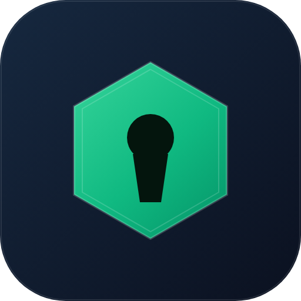
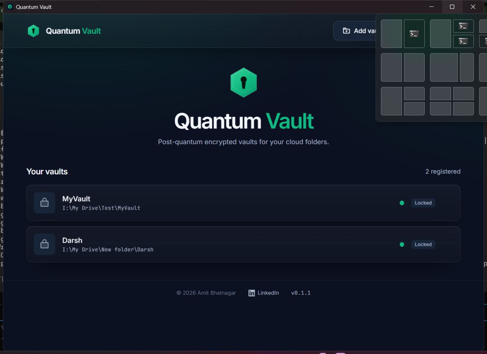

# Quantum Vault — Desktop

<p align="center">
  
</p>

**Post-quantum encrypted file vault for Windows.** Encrypt files into any
cloud-synced folder — Google Drive, OneDrive, Dropbox — so they're stored as
opaque ciphertext that syncs to the cloud automatically. No OAuth, no cloud API:
the provider never sees anything readable.

<p align="center">
  <a href="https://github.com/bamit99/QuantumVault-Desktop/releases/latest"></a>
  
  
</p>

<p align="center">
  
</p>

---

## Download

Grab the latest build from **[Releases](https://github.com/bamit99/QuantumVault-Desktop/releases/latest)**:

| File | Use it if you want |
|---|---|
| `quantum-vault-desktop.exe` | **Portable** — double-click and run, nothing installed |
| `Quantum.Vault_<ver>_x64-setup.exe` | **Installer** — Start Menu shortcut + uninstaller |
| `Quantum.Vault_<ver>_x64_en-US.msi` | **MSI** — managed/silent deployment |
| `quantum-vault-codesign.cer` | Trust the publisher — see [SIGNING.md](SIGNING.md) |

**Requirements:** Windows 10 or 11. WebView2 is preinstalled on both; nothing else
(Node, Rust, a browser) is needed. The app is a native `.exe` — the UI runs in an
embedded WebView2, so there is no server and no URL.

> Signed with a self-signed certificate. On a machine that has not trusted the
> certificate, Windows shows the standard SmartScreen prompt
> (**More info → Run anyway**). Importing `quantum-vault-codesign.cer` removes it
> and shows the verified publisher name.

---

## Why post-quantum?

Most file encryption is vulnerable to **"harvest now, decrypt later"** — an
attacker stores your ciphertext today and decrypts it once a large-scale quantum
computer exists. Quantum Vault uses a **hybrid KEM** so that even a quantum
computer cannot recover your files:

| Layer | Primitive | Role |
|---|---|---|
| Post-quantum KEM | **ML-KEM-768** (FIPS 203) | Quantum-resistant key encapsulation |
| Classical KEM | **X25519** | Fast, widely-trusted ECDH |
| Key derivation | **Argon2id** (256 MiB) | Memory-hard passphrase hashing |
| File encryption | **AES-256-GCM** | Authenticated confidentiality |

The file key is wrapped by both a **device leg** (hybrid X25519 + ML-KEM) and a
**passphrase leg** (Argon2id). These are two *alternative* unlock paths: the
hybrid KEM protects the device-bound leg, while recovery on another machine uses
the passphrase leg. **Practical security of a stolen vault therefore rests on
your passphrase strength, hardened by Argon2id** — see [SECURITY.md](SECURITY.md)
for the exact threat model.

## How it works

1. **Create a vault** — pick a cloud folder and a passphrase. The app creates an
   encrypted vault folder inside it.
2. **Add files or folders** — each file is encrypted with a fresh 256-bit key,
   wrapped by the hybrid KEM *and* your passphrase. Original names and metadata
   are hidden inside the ciphertext (on-disk names are random).
3. **Sync** — your cloud client (Drive/OneDrive/Dropbox) syncs the ciphertext as
   ordinary opaque files.
4. **Unlock anywhere** — the same passphrase unlocks the vault on any machine
   (cross-device recovery), while the device key (sealed with Windows **DPAPI**)
   still protects at rest.

## Features

- 🔐 **ML-KEM-768 + X25519 hybrid** key encapsulation
- 🧩 **AEAD context binding** — blobs are bound to their vault and file ID
- 🛡️ **Path-traversal safe** — filenames validated in the Rust backend
- 📁 Encrypt **entire folders** recursively (structure preserved, links skipped)
- 👁️ **In-app preview** of images and text without extracting
- 🧠 **Multiple vaults** — each with its own passphrase and lock state
- 🟢 **Availability check** — shows whether a vault's folder is still present
- 🏷️ **Custom folder icon** — the vault folder shows a distinct icon in Explorer
- 🖥️ **Modern, custom UI** — dark theme, no stock Windows chrome

## Getting started (development)

Prerequisites: [Rust](https://rustup.rs) (MSVC toolchain), [Node.js](https://nodejs.org) ≥ 18,
and [WebView2](https://developer.microsoft.com/microsoft-edge/webview2/) (preinstalled on Windows 10/11).

```bash
git clone https://github.com/bamit99/QuantumVault-Desktop.git
cd QuantumVault-Desktop
npm install
npm run tauri dev
```

## Build from source

```bash
npm run tauri build      # produces the portable exe + NSIS and MSI installers
npm run sign             # signs the portable exe (see SIGNING.md)
```

Outputs:

```
src-tauri/target/release/quantum-vault-desktop.exe        # portable
src-tauri/target/release/bundle/nsis/*-setup.exe          # NSIS installer
src-tauri/target/release/bundle/msi/*.msi                 # MSI
```

Installers are signed during bundling. The standalone exe is re-patched by the
final bundler pass, so it is signed afterwards by `npm run sign`.

## Architecture

- **Frontend:** React 19 + TypeScript + Vite 8 + Tailwind CSS 4 + Motion
- **Backend:** Rust (Tauri 2), with `ml-kem`, `x25519-dalek`, `argon2`, `aes-gcm`
- **Key storage:** device private keys sealed with Windows DPAPI

```
src-tauri/src/
├── crypto/        # aead (AES-GCM+AAD), kdf (Argon2id), kem (hybrid), format, dpapi
├── paths.rs       # filename/path validation, link detection
├── vault.rs       # vault lifecycle (create / open / unlock)
├── manifest.rs    # per-file encrypted metadata sidecars
├── session.rs     # unlocked-session file operations
├── registry.rs    # persisted list of known vaults
└── folder_icon.rs # desktop.ini custom folder icon
```

> ⚠️ **No recovery.** Your passphrase is never stored or recoverable. If you lose
> it, your files are gone. The `vault.meta` file is essential — deleting it makes
> the vault permanently unreadable.

## Security

Please read [SECURITY.md](SECURITY.md) before storing sensitive data. It documents
the threat model, the key-wrapping trade-offs, and current limits.

## Code signing

The released binaries are signed with a self-signed certificate. See
[SIGNING.md](SIGNING.md) to verify the signature or trust the certificate.

```powershell
Get-AuthenticodeSignature .\quantum-vault-desktop.exe | Format-List Status, SignerCertificate
```

## Author

Built by [Amit Bhatnagar](https://www.linkedin.com/in/amitxbhatnagar/).

## License

Free for personal use. See [LICENSE](LICENSE.md) for terms.
